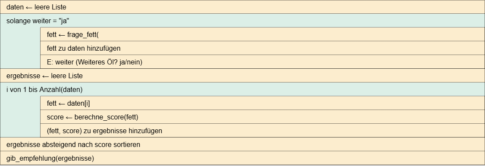
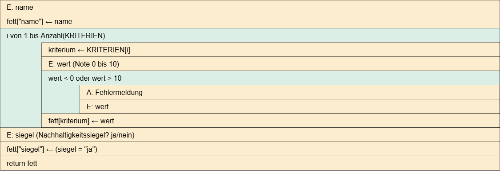
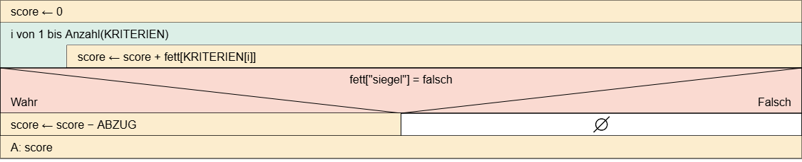
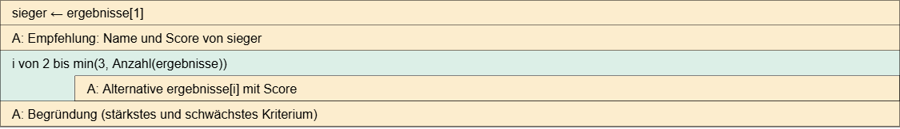

# Informatik-Python-Projekt

## Struktugramme
---------------------------
Hier sind alle für das Programm verwendeten Programme zu sehen
### Haubtprogramm:

[Als datei hier klicken](hauptprogramm_struktog.json)

---------------------------
### Funktionsblock: 
#### Frage nach dem Fett:

[Als datei hier klicken](frage_fett_struktog.json)

---------------------------
#### Berechnen der Bewertung

[Als datei hier klicken](berechne_score_struktog.json)

---------------------------
#### Ausgabe der Empfehlung

[Als datei hier klicken](gib_empfehlung_struktog.json)

---------------------------